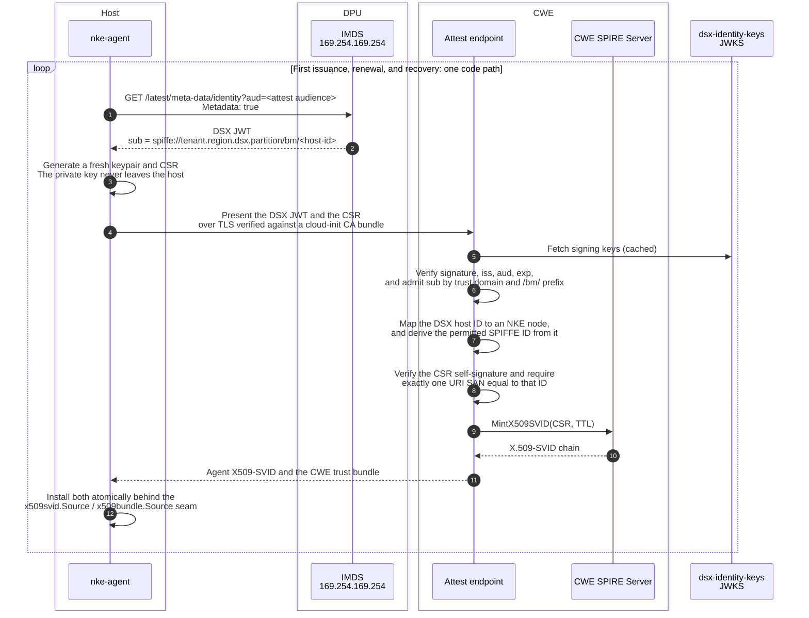

# Node agent attested identity

> Status: draft for cross-team review
>
> Audience: NKE controller team, DSX identity team, NKE agent team
>
> Tracks: not yet filed

## What this document is for

DSX sites need `nke-agent` to obtain its serving certificate from a DPU-backed
attestation rather than from a TPM quote. The agent-side mechanics are built and
tested. What is not settled is the contract between three components owned by
three teams, and this document exists to settle it.

Read [Decisions needed](#decisions-needed) first if you are short on time. It is
the whole ask. Everything before it is the reasoning, and everything after it is
detail for whoever implements a given piece.

Every claim about existing code here was checked against the source at the paths
cited. If you reviewed the previous revision, four of its claims did not survive
that check and one of them changed the design:

- The agent cannot get a verifiable JWT-SVID on the DSX side, which is the
  design change. See [What changed and why](#what-changed-and-why).
- `POST /v1/exchange` cannot verify a DSX JWT, so CWE cannot proxy through it.
- `Node.GetTPMSpiffeID` does not exist. The real accessor is `Node.GetSpiffeID`
  (`controller/internal/db/nodes.go:60-63`).
- The controller has no gRPC server, which reopens
  [decision 5](#decisions-needed).

## The two layers, and why only one of them is the hard part

**Layer 1 is host attestation.** A host-local SPIRE agent proves which host it
is before the SPIRE server issues anything. Today that is a TPM quote against an
allowlist of EK public key hashes. DSX sites replace it with `dsx_imds`, where
the SPIRE agent fetches a short-lived JWT from the link-local metadata endpoint
`169.254.169.254` served by the DPU paired with that host. The DPU is
hardware-attested and the control plane holds the authoritative DPU-to-host
pairing, so the assertion comes from a trusted third party rather than from the
host's own hardware. **This layer is built and owned by the DSX identity team**
(`dsx-identity/cmd/dsx-imds-node-attestor-{agent,server}`).

**Layer 2 is how `nke-agent` gets the certificate it serves gRPC with.** Today
it reads an X509-SVID off the local SPIFFE Workload API, which requires the
agent and the controller to be peers in one SPIFFE trust domain. Replacing that
with an explicit exchange is the new work, and its payoff is that it makes
Layer 1 **trust-domain independent**: a host attested by the DSX SPIRE server
can serve an identity minted by CWE's SPIRE server with no federation between
them.

The rest of this document is about Layer 2.

## What changed and why

The earlier revision assumed `nke-agent` would fetch a **JWT-SVID from the local
Workload API** and that CWE would verify it via JWKS. Checking that against
`dsx-identity` turned up two problems, one of them decisive.

**1. CWE cannot verify a SPIRE JWT-SVID from the DSX trust domain.** The
`spiffe-oidc-discovery-provider` is disabled in the chart
(`charts/dsx-identity/values.yaml:95-96`), so a DSX JWT-SVID carries an `iss`
claim with no discoverable JWKS behind it. There is nothing for CWE to fetch.
This is the blocker, and it holds regardless of anything else.

**2. Host-process token delivery is explicitly deferred.** The mechanism exists:
once the host agent completes `dsx_imds` node attestation, its **Unix
WorkloadAttestor** does serve host processes
(`cmd/dsx-imds-node-attestor-agent/README.md:9-12`). What is missing is the
contract for registering one. Every entry `dsx-identity` creates today targets a
Kubernetes Pod, a DPU workload, or a KubeVirt VM by `k8s:` selectors
(`charts/dsx-identity/templates/operator-identities.yaml:13-17`,
`internal/identitycontroller/`), and the architecture table says so plainly:

> The host agent is attested through the repository `dsx_imds` NodeAttestor
> agent and server, then can serve local processes through the Unix
> WorkloadAttestor. [...] A host-process-specific token delivery contract is
> not currently defined.
>
> `dsx-identity/README.md:345`

The same status appears as "host-process token delivery deferred" in each of the
four topology diagrams (`README.md:74, 92, 156, 172`).

**A note on the exchange endpoint**, since it came up as a possible bridge and
is not one. `POST /v1/exchange` on `dsx-identity-keys` consumes a **local SPIRE
JWT-SVID** and returns a DSX JWT, so CWE cannot use it to verify a DSX JWT it
was handed. Separately, and worth the identity team's attention regardless of
this design: it validates its subject token with
`jwtsvid.ParseAndValidate(subjectToken, s.jwtSource, nil)`
(`cmd/dsx-identity-keys/main.go:161`), where `nil` is the expected-audience
argument, so **the exchange enforces no audience**. Any holder of any JWT-SVID
for any audience can exchange it for a DSX JWT.

### The three options

| | How `nke-agent` gets its token | CWE verifies via | Needs from DSX identity | Scope of the assertion |
|---|---|---|---|---|
| **A (recommended)** | Calls IMDS directly over HTTP | `dsx-identity-keys` JWKS | Confirmation that direct host access is supported | Host |
| **B (blocked)** | JWT-SVID from the Workload API | Nothing available | A JWKS for SPIRE JWT-SVIDs, plus a host-process entry | Workload |
| **C (viable, more work)** | JWT-SVID from the Workload API, then exchanges it itself | `dsx-identity-keys` JWKS | A host-process registration entry contract | Workload |

**Option A** works today with no new DSX-side machinery. The metadata endpoint
is a plain HTTP service that `nke-agent` can call itself, with no SPIRE agent,
no registration entry, and no Workload API:

```
GET http://169.254.169.254/latest/meta-data/identity?aud=<audience>
Metadata: true
Accept: text/plain
```

It returns a raw compact DSX JWT (`internal/dsximds/agent.go:15-33`,
`cmd/metadata-service/main.go:208-262`) issued by `dsx-identity-keys`, which
**does** publish a JWKS at `/.well-known/jwks.json` behind a configured public
URL (`identityKeys.jwksURL`, `charts/dsx-identity/values.yaml:143`;
`cmd/dsx-identity-keys/main.go:254-256`). That is verifiable by an ordinary OIDC
client, which CWE already has in `internal/auth`.

**Option B is dead** unless the identity team enables an OIDC discovery provider
for the DSX SPIRE server, which they have deliberately turned off.

**Option C is the upgrade path**, and the reason to keep it in view is that it
is the only one that makes the assertion workload-scoped rather than host-scoped
(see [decision 2](#decisions-needed)). The agent would obtain a JWT-SVID through
the Unix WorkloadAttestor with `aud` set to the attest audience, then call
`/v1/exchange` itself and present the resulting DSX JWT, which CWE verifies
through the same JWKS as option A. The exchange preserves `aud` from the input
SVID (`cmd/dsx-identity-keys/main.go:101-104`), so audience pinning survives it.
The cost is that it needs the deferred host-process registration contract, and
it puts `nke-agent`'s identity back behind successful node attestation.

**The recommendation is A now, with C as the migration if decision 2 comes back
unacceptable.** The two differ only in the `TokenSource` implementation on the
agent side, which is one interface with one method, so the choice is reversible
at low cost and does not need to block the rest of the work.

## The recommended flow



Two things the diagram leaves to prose. The agent verifies the attest endpoint's
own TLS certificate against a CA bundle injected by cloud-init, which is what
keeps the JWT from being handed to an impostor. And refusal paths are omitted to
keep the happy path readable, the significant one being that a refused renewal
must leave a still-valid certificate serving rather than tear down a working
listener.

The ordering of the three verification steps is the security argument, not
presentation. The permitted SPIFFE ID is **derived from the verified subject**
and only then compared against the CSR, so the request never gets to name the
identity it is asking for.

### What this buys

**Under option A, `nke-agent` no longer depends on SPIRE at all.** No
registration entry, no Workload API, no ordering against `spire-agent.service`,
and no `wait-spiffe-socket.sh` on the DSX path. The host still runs a SPIRE
agent for Kubernetes workloads on the node, but `nke-agent`'s own identity is
independent of whether that agent has attested. This deletes most of the
`ClusterStaticEntry` producer work the earlier revision scoped, and it removes
the failure mode where a registration-entry parent mismatch silently yields no
SVID and nothing reports why. Option C gives this benefit back up in exchange
for workload-level scoping.

**Trust-domain independence.** CWE validates the agent by JWKS rather than by
being a SPIFFE peer, so the DSX SPIRE server and CWE's SPIRE server need no
federation and need not be the same server.

**Failures become loud.** A refusal is an HTTP response with a reason, from a
service that already distinguishes its refusal reasons, rather than an SVID that
never arrives.

**The private key stays on the host.** `MintX509SVID` conveys the public key and
the SPIFFE ID through a CSR. The only bearer credential in the flow is the DSX
JWT, and it is short-lived, audience-pinned, and never written to disk.

### The property to accept deliberately

**The DSX JWT is a host-level assertion, not a workload-level one.** The IMDS
endpoint authenticates nothing: any process on the host that can reach
`169.254.169.254` can request a token, for any audience it names. So the token
proves *which host is asking* and not *which process on it*.

That is coherent with what is being issued, since the minted certificate is a
host identity (`/host/<node-uuid>`) and `nke-agent` runs as root, so any process
that could steal the token could equally read the agent's key off the host. It
is a genuine reduction against the JWT-SVID model, though, where the SPIRE agent
attests the calling workload. It should be an accepted tradeoff rather than an
unnoticed one, and it is [decision 2](#decisions-needed). Option C is the remedy
if it is judged unacceptable, at the cost of a registration-entry contract that
does not exist yet.

### What does not change

| Untouched | Why |
|---|---|
| `authorizeClient` in the agent | The controller still presents its own X509-SVID, so the agent still matches peer trust domain plus the `/nke-service/` and `/tenant/nke/service/` prefixes (`agent/cmd/agent/main.go:112-136`) |
| mTLS on the agent's gRPC server | Considered dropping to one-way TLS and rejected. See [mTLS stays](#mtls-stays) |
| The controller's dial-out | `MTLSClientCredentials(..., tlsconfig.AuthorizeID(expectedID))` still works, because the minted cert is a real SVID chaining to the CWE bundle (`controller/internal/agent/client.go:117-130`) |
| The agent's SPIFFE ID | Still `spiffe://<trust-domain>/host/<node-uuid>` from `Node.GetSpiffeID` (`controller/internal/db/nodes.go:60-63`) |
| `os-image` connectivity checker | Still a trust-domain match against the agent SVID |

### mTLS stays

The original sketch had the minted certificate enabling one-way TLS. On review
there is no reason to give up client authentication, and good reason not to: the
agent's gRPC surface includes `ExecuteScript`, `GetKubeconfig`,
`UploadFileBundle`, and `PatchAPIServerManifest`, among 48 RPCs. Dropping mTLS
would make network position sufficient to drive `kubeadm` on any node.

Minting an SVID rather than issuing from a private controller-side CA is what
keeps mTLS free. A private PKI would have needed a second TLS client path in the
controller and would have replaced the agent's SPIFFE path-prefix check with
something new, and if one CA signed both agent and controller certificates, any
node could have dialed any other node. Minting leaves the existing authorization
model exactly as it is.

## Decisions needed

These are the things that need a yes or a no before implementation proceeds.
Each is owned by a specific team.

| # | Decision | Owner | Blocks |
|---|---|---|---|
| 1 | Is calling IMDS directly from a host process a supported, stable pattern? | DSX identity | Option A vs C, and the agent's `TokenSource` |
| 2 | Accept that the DSX JWT identifies the host and not the process | Security, DSX identity | Design signoff |
| 3 | Who owns the DSX-host-ID to NKE-node mapping, and where does it come from? | NKE controller, DSX identity | Controller implementation |
| 4 | Is `identityKeys.jwksURL` reachable from CWE, and what is its rotation story? | DSX identity | Controller implementation |
| 5 | REST or gRPC for the attest endpoint | NKE controller | Endpoint implementation |
| 6 | Certificate TTL, renewal fraction, and the revocation window | NKE controller, Security | Operational tuning only |

### 1. Direct IMDS access from a host process

Under option A, `nke-agent` calls `169.254.169.254` itself rather than going
through a SPIRE agent. The endpoint is built to serve host identity and takes a
caller-supplied audience, so this looks like intended use, but host-process
delivery is marked deferred in the DSX architecture and we should not build on
something that happens to work.

**Ask:** confirm that a non-Kubernetes host process calling
`GET /latest/meta-data/identity?aud=...` is supported, and that the path, the
`Metadata: true` header requirement, the `aud` query parameter, and the
`text/plain` raw-JWT response are stable interfaces we can depend on.

**If the answer is no**, the fallback is option C, which needs the identity team
to define host-process token delivery and create a per-host registration entry
whose subject is per-host unique. A shared subject would leave the attest
endpoint unable to tell which host is asking, which collapses
[invariant 1](#invariants-the-attest-endpoint-must-hold).

### 2. Host-level rather than workload-level assertion

See [The property to accept deliberately](#the-property-to-accept-deliberately).

**Ask:** security and identity to confirm this is acceptable for the DSX threat
model, given that the credential being obtained is a host identity and the
requesting process already runs as root.

### 3. The identity mapping, which is the largest open item

The two identities do not share a namespace:

| | Format | Example |
|---|---|---|
| DSX JWT subject | `spiffe://<tenant>.<region>.dsx.<partition>/bm/<resource-id>` | `spiffe://operator-1.ds9.dsx.nvid.id/bm/host-7` |
| NKE agent identity | `spiffe://<nke-trust-domain>/host/<node-uuid>` | `spiffe://site.nke.nvidia.com/host/<uuid>` |

CWE has to map the DSX bare-metal resource ID to an NKE node UUID, and that
mapping is the security boundary. If it is wrong or spoofable, a valid token for
host A yields a serving certificate for host B, which is exactly what
[invariant 1](#invariants-the-attest-endpoint-must-hold) exists to prevent.
NKE has no such field today.

**Ask:** decide where the mapping comes from and who writes it. The plausible
sources are the DSX bare-metal resource ID arriving through the existing
inventory or CAPI machine path and being persisted on the node record, or CWE
querying a DSX inventory API at attest time. The first is preferable because it
keeps attest independent of another live service, but it depends on the ID being
available at node creation.

Also confirm the tenant component. The DSX trust domain embeds the tenant
(`<tenant>.<region>.dsx.<partition>`,
`dsx-identity/internal/dsxidentity/identity.go:69-88`), so a site serving
multiple tenants presents multiple trust domains and CWE needs an admission rule
per tenant rather than one.

### 4. JWKS reachability and rotation

CWE must reach `dsx-identity-keys`'s JWKS to verify. The chart defaults the
service to `ClusterIP` (`values.yaml:140`) and requires an explicitly configured
public URL (`values.yaml:143`), so reachability is a per-site deployment
question rather than a given.

**Ask:** confirm the URL CWE should use per site, whether it needs a CA bundle
(`internal/auth` supports `caBundlePath` per issuer), the `iss` value to pin,
and how signing keys roll.

### 5. REST or gRPC

The original sketch specified a gRPC client in the agent. Worth revisiting,
because **the controller has no gRPC server today**: its external API is
REST via OpenAPI and `oapi-codegen` over `net/http.ServeMux`
(`controller/internal/server/server.go:33-62`), and the only `grpc.NewServer`
calls under `controller/` are in test fixtures.

The recommendation is to split by direction rather than pick one:

| Direction | Transport | Rationale |
|---|---|---|
| Agent to controller (attest) | REST, `POST /api/v1/attest` | Reuses the existing server, request validation, and `internal/auth` middleware unchanged. Adding a first gRPC server to the controller for one endpoint is a new listener, new TLS configuration, and a new auth path |
| Controller to agent (rotate push) | New gRPC RPC on `NodeAgent` | The controller already dials the agent over mTLS gRPC. The trigger is one new RPC on an existing channel |

That way no new gRPC server is introduced anywhere. **Ask:** the controller team
to confirm, or to say why a gRPC attest endpoint is worth the new surface.

### 6. TTL, renewal, and revocation

`MintX509SVID`'s TTL is advisory and capped by the SPIRE CA's remaining
lifetime, so long-lived agent certificates are not available to ask for. The
certificate TTL **is** the revocation window here, since revocation works by
refusing the next renewal, so the number that helps availability hurts
revocation speed. Pick it on purpose.

## Renewal: push with pull as the backup

Renewal is the same exchange as first issuance, deliberately. One endpoint, one
set of invariants, and each renewal re-presents a freshly fetched token, so the
assertion that admitted the host is re-verified rather than trusted indefinitely
from enrollment. Bootstrap, scheduled renewal, and recovery are the same code
path.

**The agent renews itself on a timer, and the controller may also push.** The
push is the primary schedule and the timer is the backstop, and the backstop is
the part that matters. A push-only design has a circular dependency: the
controller reaches the agent over the very certificate that is expiring, so once
it lapses, the channel that would have commanded renewal is gone and recovery is
manual. That failure has bitten this team before on pre-SPIFFE implementations,
where a controller or node outage outlasting certificate expiry required hands
on the node.

The agent therefore renews part way through each certificate's life without
being asked, defaulting to half, which leaves the entire second half as retry
window. A push renews immediately instead of waiting out the timer, which is
what makes deliberate rotation prompt. Both paths run the same exchange.

Two invariants carry this:

- **A failed renewal never discards a usable certificate.** The listener keeps
  serving the current identity, and the node goes unreachable at expiry rather
  than at the moment of refusal.
- **An identity that never arrives is retried indefinitely.** A host that cannot
  reach CWE yet may reach it later, and exiting only loses the diagnostics.

Alert on sustained renewal failure while the current certificate is still valid.
That window is the entire warning you get.

## Invariants the attest endpoint must hold

These are the checks that carry the design. Each should have a test that fails
loudly if it is removed.

1. **The CSR's URI SAN must equal the SPIFFE ID derived from the verified
   subject.** `MintX509SVID` takes the SPIFFE ID *from the CSR*, so an endpoint
   that mints what the CSR asks for lets a valid token from host A obtain a
   serving certificate for host B. Derive the identity from the subject, then
   compare, never the reverse.
2. **The CSR's own signature must verify.** Without it the endpoint mints a
   certificate binding a verified host's identity to whatever public key the
   request carried, including one whose private key the requester does not hold.
   This is proof of possession, and in Go it is
   `x509.CertificateRequest.CheckSignature`.
3. **The audience must be the attest endpoint and nothing else.** The `aud` is
   caller-chosen at the IMDS endpoint, so a token minted for the SPIRE server,
   a tenant apiserver, or any other audience must not be replayable here. Note
   that the SPIRE server node attestor uses a different audience for the same
   token type (`spiffe://<td>/spire/server`), which is exactly the separation
   this invariant preserves.
4. **Exactly one URI SAN, and no DNS SANs or subject.** The SPIRE API permits
   only one URI SAN, and more should be refused rather than silently resolved.
5. **The subject must be admitted by path prefix, not merely by trust domain.**
   `internal/auth` already requires a non-empty `pathPrefixes` for this reason.
   Admit `/bm/` in the configured DSX trust domain.
6. **Issue only for hosts NKE knows.** A verified subject proves which host is
   asking, not that NKE should serve it. The node must resolve through the
   mapping in decision 3 and must not be deleted.

`internal/auth` covers 3 and 5 and part of 6 as it stands, and its audience
validation already refuses the values that make an `aud` check vacuous, meaning
wildcards, an audience equal to a configured issuer, and the
`kubernetes.default.svc` forms every automounted pod token carries.
Reimplementing verification for this endpoint would mean reimplementing those
guardrails. Mount the existing authenticator.

The DSX subject fits its existing `SPIFFERule` shape without modification
(`controller/internal/auth/config.go:128-136`):

```yaml
issuers:
  - name: dsx-identity
    issuer: https://<identityKeys issuer>
    audiences: ["<the attest audience>"]
    jwks:
      uri: https://<identityKeys.jwksURL>
      caBundlePath: /etc/nke/dsx-jwks-ca.pem
    admit:
      spiffe:
        trustDomain: operator-1.ds9.dsx.nvid.id
        pathPrefixes: ["/bm/"]
```

## What already exists

| Capability | Where | State |
|---|---|---|
| `dsx_imds` node attestor, agent and server | `dsx-identity/cmd/dsx-imds-node-attestor-{agent,server}` | Built, owned by DSX identity |
| DSX JWT issuance and JWKS | `dsx-identity/cmd/dsx-identity-keys` | Built. Public URL is per-site config |
| JWT verification against JWKS | `controller/internal/auth/` | Built. Multi-issuer, audience allowlist, SPIFFE path-prefix admission, enforcing and permissive modes |
| Authenticated channel to the SPIRE server | `controller/internal/spiffe/join_token.go:52-60` | Built, for `CreateJoinToken`. `MintX509SVID` is new but rides the same channel |
| Trust bundle retrieval | `controller/internal/spiffe/spiffe.go:17-52` | Built, already used for cloud-init |
| Retrying identity acquisition with status reporting | `agent/internal/identity/identity.go`, `agent/internal/agent/status.go` | Built this cycle |
| Atomic certificate and bundle rotation | `agent/internal/identity/rotating.go` | Built this cycle |
| Keypair and CSR generation | `agent/internal/identity/csr.go` | Built this cycle |
| Renewal loop, push trigger with timer backstop | `agent/internal/identity/renewer.go` | Built this cycle, against a fake attestor |
| The attest endpoint | `controller/internal/server/` | **Not built.** Decisions 3, 4, 5 |
| `MintX509SVID` call | `controller/internal/spiffe/` | **Not built** |
| DSX-host-ID to node mapping | nowhere | **Not built.** Decision 3 |

The agent-side work is behind two interfaces, so it is already exercised
end-to-end against a fake controller that mints from a test CA and enforces
proof of possession:

```go
type TokenSource interface {
    Token(ctx context.Context) (string, error)
}

type Attestor interface {
    Attest(ctx context.Context, token string, csrDER []byte) (*Issued, error)
}
```

Settling decisions 1 and 5 turns those into two adapters of roughly a hundred
lines each. Everything behind them is done and tested.

## Change set by module

### `agent/`

| Change | Where | State |
|---|---|---|
| `TokenSource` over the IMDS endpoint | `internal/identity` | Blocked on decision 1 |
| `Attestor` over the attest transport | `internal/identity` | Blocked on decision 5 |
| Keypair and CSR generation | `internal/identity/csr.go` | Done |
| `x509svid.Source` and `x509bundle.Source` over minted material | `internal/identity/rotating.go` | Done |
| Renewal loop, never discarding a usable certificate | `internal/identity/renewer.go` | Done |
| A `Rotate` RPC to accept the push trigger | `pkg/agent/proto/node_agent.proto` | Not built. No such RPC exists today, and `StartKubernetesCertificateRenewal` is Kubernetes control-plane certificates, unrelated |
| Distinguish "no token from IMDS" from "attest unreachable" in `SPIFFEStatus` | `internal/agent/status.go` | Partial. Different owners, different fixes, so they should not collapse to one state |
| Attest endpoint URL and CA bundle as flags | `cmd/agent/main.go` | Not built |
| Keep `authorizeClient` and its table test as they are | `cmd/agent/main.go:112-136` | No change |

The renewal branch has to replace **both** the serving certificate and the trust
bundle, which rules out the obvious implementation:
`tls.Config.GetCertificate` rotates only the certificate, while the bundle is
what verifies the controller's SVID. The route taken avoids the problem
entirely, because `tlsconfig.MTLSServerConfig` takes `x509svid.Source` and
`x509bundle.Source` as *interfaces*, so the agent satisfies them itself over
minted material. Rotation is a swap behind those interfaces, and
`buildSpiffeMtlsConfig` including its authorizer is unchanged.

### `controller/`

| Change | Where |
|---|---|
| The attest endpoint, mounting `internal/auth` | `api/openapi.yaml` then `internal/server/` |
| `MintX509SVID` alongside `CreateJoinToken` on the same admin channel | `internal/spiffe/` |
| DSX host ID persisted on the node, and the lookup | `internal/db/nodes.go`, decision 3 |
| DSX issuer, audience, and JWKS configuration | `internal/config/config.go`, Helm values |
| A `Rotate` push to the agent | `internal/agent/client.go` |
| `dsxImds` on `SpireAttestationMethod` and `SpireAttestationMethodCreate` | `api/openapi.yaml`, then `make generate` |
| `db.SpireAttestationMethodDsxIMDS` | `internal/db/node_pools.go:26-31` |
| Accept the new value, gated on the service flag | `internal/server/node_pools.go:207-215` |
| Replace the `UseJoinToken` boolean with the method | `internal/temporal/activities/capi_bootstrap_userdata.go:146`, `capi_spire_agent.conf.tmpl` |
| `DsxIMDSSpireAgentPath` constant | `internal/constants/constants.go` |

### `os-image/`

| Change | Where |
|---|---|
| `NodeAttestor "dsx_imds"` block, selected at render time | `files/spire-agent.conf.tmpl`, `files/spire-configure.sh:49-64` |
| Attest endpoint URL and CA bundle in the first-boot contract | `files/spire-configure.sh`, `/etc/nke/`, `SPEC.md` |
| Install the `dsx_imds` agent plugin binary | `packer/scripts/provision.sh`, `fetch-artifacts.sh` |

Note that the SPIRE agent work in `os-image/` is Layer 1 and is needed for
Kubernetes workloads on the node regardless. `nke-agent`'s own identity no
longer depends on it.

## Fix the fail-open before adding a third value

`SpireAttestationMethod` has exactly two values today
(`controller/internal/db/node_pools.go:26-31`), and it has several readers of
which only some are exhaustive. The rendered agent config treats attestation as
a boolean whose `else` branch means TPM:

```23:33:/home/jgriffith/src/NVIDIA/nke/controller/internal/temporal/activities/capi_spire_agent.conf.tmpl
{{- if .UseJoinToken }}
    NodeAttestor "join_token" {
        plugin_data {}
    }
{{- else }}
    NodeAttestor "tpm" {
        plugin_cmd = "/usr/local/lib/spire-agent/tpm_attestor_agent"
        plugin_checksum = "${TPM_PLUGIN_CHECKSUM}"
        plugin_data {}
    }
{{- end }}
```

fed by `UseJoinToken: attestationMethod == db.SpireAttestationMethodJoinToken`
(`capi_bootstrap_userdata.go:146`). Add `dsxImds` without touching this and a
`dsxImds` pool renders a **TPM** agent config. The node is configured for the
wrong attestor and the only symptom is that it never attests.

| Site | Current shape | Risk |
|---|---|---|
| `capi_spire_agent.conf.tmpl:10,23` | `if UseJoinToken / else TPM` | Renders TPM for any new method |
| `capi_bootstrap_userdata.go:146` | Boolean projection of the enum | Erases the third value |
| `os-image/files/spire-configure.sh:49-64` | `SPIRE_JOIN_TOKEN` set, else TPM | Same fail-open on the non-CAPI path |
| `nodeclusterstaticentry/controller.go:158-159` | `not` TPM path prefix | Accepts a typo as a valid handoff |
| `nico_tpm_spiffe_controller.go:79-82` | `not` TPM path prefix | Same |
| `nodetpmekpub/controller.go:171` | `!= tpm`, skip | Correct as written, a positive check |

## Phasing in alongside TPM

Coexistence is already the design. `capiSpireAttestationMethod` is persisted per
node pool and per control-plane config, and TPM and join-token nodes already run
side by side, so `dsxImds` is a third value and the phase-in unit is the node
pool.

| Lever | Level | Question it answers |
|---|---|---|
| `SPIRE_DSX_IMDS_ENABLED` config flag | Deployment | *Is this site capable of `dsx_imds` at all?* |
| `capiSpireAttestationMethod: dsxImds` | Node pool | *Does this pool use it?* |

The service flag stops an operator selecting `dsxImds` at a site whose DPU-side
prerequisites are not deployed, where the failure is a host that never attests
and reports nothing. Default it off and declare it beside `SPIFFE_ENABLED`.

**The flag gates admission and nothing else.** Evaluate it when the pool is
written, persist the decision, and never re-derive it.
`validateCAPISpireAttestationMethod` (`internal/server/node_pools.go:207-215`)
is the only place it belongs. A reconciler consulting it live would, on the flag
being turned off, rewrite the identity of already-attested healthy nodes and
revoke them, turning a config change meant as a safety measure into a fleet
outage.

### Sequencing on a host

Prove a bounded `curl` to `169.254.169.254` returns a token, then prove the
attest exchange returns a certificate, and only then move the host off TPM.
Moving the attestor first strands the host with no identity.

## Failure modes

| Failure | Where | Symptom |
|---|---|---|
| No response from `169.254.169.254` | DPU datapath, FMDS, HBN service chain | No token, so no attest. Agent reports `waiting` and retries |
| IMDS returns a token for an unknown host | DSX inventory | Attest refuses at the mapping step |
| JWKS unreachable from CWE | Network or per-site config | Attest refuses every request. This is a site-wide outage of new issuance, so alert on it directly |
| Attest refuses at first issuance | CWE | HTTP refusal with a typed reason, the one properly diagnosable failure |
| Attest refuses a **renewal** | CWE, usually deliberate revocation | Must leave the still-valid certificate serving. The node goes unreachable at expiry, not at refusal |
| Attest unreachable | Network or CWE outage | Agent keeps serving its current certificate and retries until expiry |
| CSR URI SAN mismatch | CWE | Refusal. Would be a cross-host issuance bug if unchecked |

The dependency shift worth naming: a CWE outage lasting longer than the
certificate lifetime makes the fleet unreachable by the only component that can
reissue. This is a *change* of dependency rather than a new one, since today the
host must reach CWE's SPIRE server on 8081 for its SVID to rotate at all, but it
should be decided deliberately as part of decision 6.

## See also

- [architecture.md](architecture.md) — how the controller and agent talk
- [../agent/docs/SECURITY.md](../agent/docs/SECURITY.md) — the node agent's threat model
- [../controller/docs/configuring-api-authentication.md](../controller/docs/configuring-api-authentication.md) — the JWT/JWKS authenticator this reuses
- [../os-image/SPEC.md](../os-image/SPEC.md) — the contract a node image has to meet
- `dsx-identity/cmd/dsx-imds-node-attestor-agent/README.md` — the DPU attestation flow
